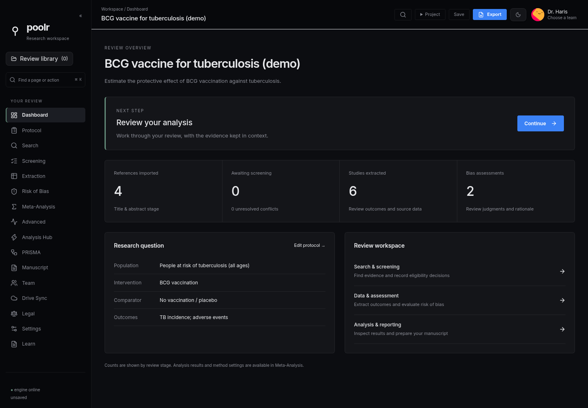
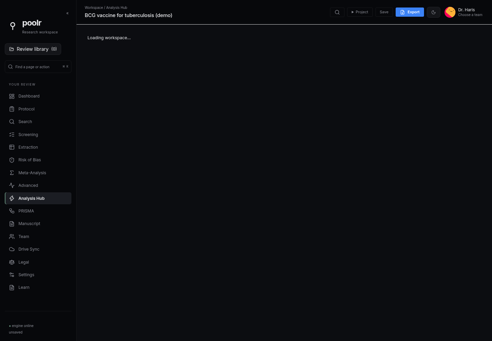

# Poolr

A desktop workspace for systematic reviews and meta-analysis: define the question, find records, screen studies, extract data, assess bias, analyse results and prepare a manuscript.

**v0.6.4 release candidate** · [Installers and releases](https://github.com/harisawan-bit/poolr/releases) · [Build status](https://github.com/harisawan-bit/poolr/actions/workflows/build.yml) · [Release notes](docs/RELEASE_0.6.4.md)

## What changed

- A quieter review dashboard, collapsible navigation, readable analysis names, consistent profile avatars and logo, and improved light-theme controls.
- A learning workspace and protocol discovery links for PubMed, PROSPERO and Google Scholar. External search links are not evidence that a topic is novel.
- Native rclone storage with encrypted signing-key backups, owner-signed team membership, team switching and ended-team restrictions. No Poolr hosting service or cPanel database.
- Local revision queues, periodic Drive exchange and explicit resolution of concurrent versions. New remote versions refresh an open review when its draft is clean.
- Manuscript sections, contributor/reviewer assignments, deadlines, comments and saved checkpoints travel with the project.
- Preserved advanced-analysis data on project reopen, serialized local saves, zero-event input correction, independent full-text screening decisions and signed updater configuration.

## Start a review

Choose a profile and **New review**, select a review type, define PICO and choose data sources. **Learn meta-analysis** explains the workflow and links to methodological guidance. The BCG demo is an example dataset, not an editable production team.

Use **Project → Open / Save / Export** for local files. In the browser preview, working drafts are kept in browser storage; export JSON for a portable backup. Native file access and team signing are available only in the desktop app.

## Collaborate using your Drive

1. Configure a Google Drive remote with rclone. Rclone handles OAuth and token storage; Google authorization and an OAuth client may still be required. See [rclone's Drive guide](https://rclone.org/drive/).
2. Create a dedicated shared folder. Each collaborator connects their own configured remote to that same folder. Restrict actual Drive sharing to the intended collaborators.
3. Open **Teams & members**, create a signing identity and download its encrypted recovery backup. Keep the passphrase separately.
4. Create a team with a remote such as `research:Poolr/OurTeam`, then sync. The owner approves members' public-key requests and sends an invitation containing the owner's fingerprint and authority checkpoint.
5. Join, select the team and share a review. Periodic synchronization runs while the app is open, visible and online. Concurrent edits remain separate heads until someone reviews and publishes a resolution.

Owner: membership, assignments, end/reopen and content. Editor/reviewer: content and manuscript discussion. Viewer: read-only. Ending a team leaves only the owner able to publish. Editor and reviewer currently have the same content-write scope; section assignments coordinate work rather than grant isolated access to data.

**Security boundary:** signatures detect unauthorized permission changes; they do not prevent a Drive writer from deleting files or reading content outside Poolr. For confidentiality, configure an rclone crypt remote and distribute its key separately. Removing a member cannot erase their downloaded copies. There is no promise of uninterrupted connectivity, automatic conflict-free text merging, or audited security at thousands of simultaneous users. See [the full design and limits](docs/DRIVE_COLLABORATION.md).

## Local development

Requirements: Node 24+, .NET 8 SDK, Rust stable, and the platform prerequisites for [Tauri](https://v2.tauri.app/start/prerequisites/). Rclone must be installed for the real-transport integration test; packaged installers bundle it.

```sh
npm ci --prefix frontend
npm --prefix frontend run dev
# http://127.0.0.1:1420

dotnet test engine/Poolr.Engine.Tests/Poolr.Engine.Tests.csproj -c Release
npm --prefix frontend run test -- --run
npm --prefix frontend run lint
npm --prefix frontend run build

# Linux example; select your .NET RID on other platforms.
dotnet publish engine/Poolr.Engine.Api/Poolr.Engine.Api.csproj -c Release -r linux-x64 --self-contained true -o src-tauri/resources/engine
python3 scripts/bundle-rclone.py linux-x64 src-tauri/resources/engine
node frontend/node_modules/@tauri-apps/cli/tauri.js dev
```

The browser can use the loopback statistical engine, but cannot access signing identities, rclone credentials or arbitrary local files. Do not expose the engine port to a network. Build-time Python downloads/verifies rclone; the application runtime is React, Rust and C#.

## Packaging and updates

CI builds Windows x64/x86/ARM64, macOS Intel/Apple Silicon and Linux x64 installers into a **draft** release. Required checks run before packaging. Native platform signing/notarization is distinct from updater signing and requires the corresponding developer certificates.

v0.6.4 establishes a new updater trust key. If an old installation trusts a lost key, install v0.6.4 manually from a verified release; signature checking must not be bypassed. Private signing material is not committed to this repository.

## Screenshots

The release candidate browser preview, using the BCG demo:




[Light theme and collapsed navigation](docs/screenshots/v0.6.4/dashboard-light-collapsed.png) · [Learning workspace](docs/screenshots/v0.6.4/learn.png) · [Manuscript](docs/screenshots/v0.6.4/manuscript.png) · [Teams setup](docs/screenshots/v0.6.4/collaboration.png)

Team screenshots show the browser's native-access notice, not a simulated Drive connection. Images outside the v0.6.4 folder are historical.

## Research quality and license

Presets and statistical tools require methodological judgment. Tests cover specific numerical and workflow cases; they do not certify every analysis or make a review PRISMA-compliant automatically. Review the [Cochrane Handbook](https://www.cochrane.org/authors/handbooks-and-manuals/handbook/current/chapter-10) and the reporting guideline for your design.

This repository's [existing proprietary license](LICENSE) remains in force. Using open-source dependencies does not change Poolr's license or eliminate provider terms. Citation metadata is in [CITATION.cff](CITATION.cff).
